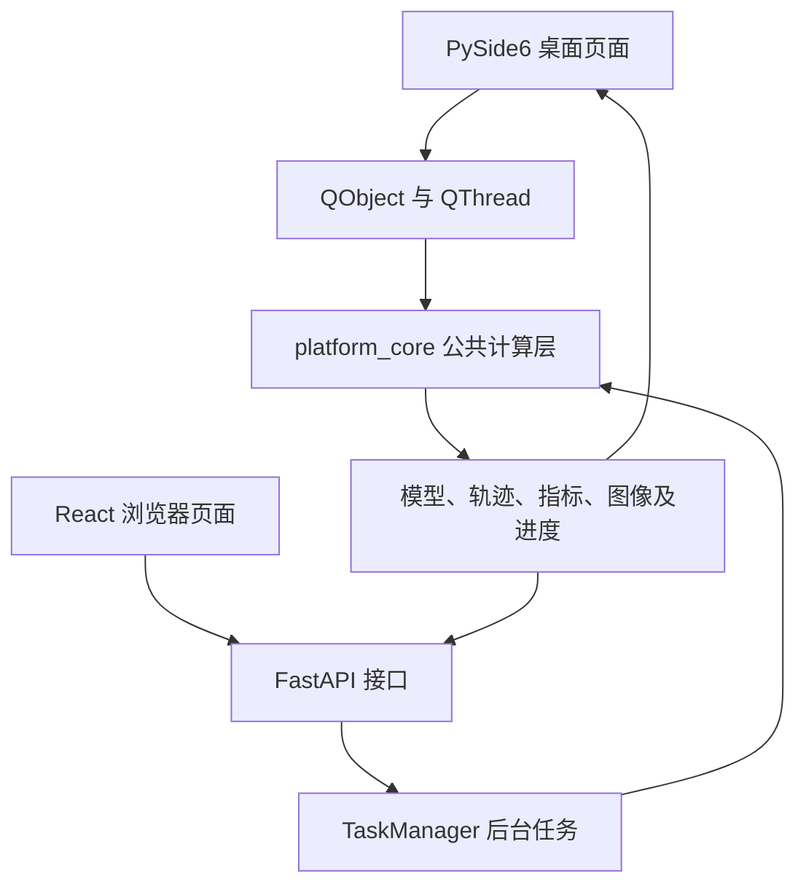
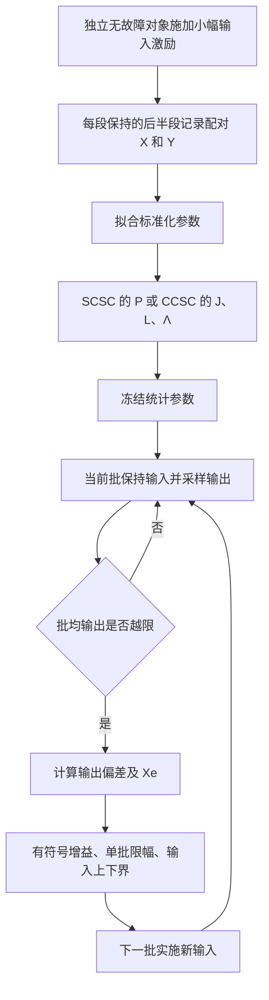

# 风险管控算法实现与使用手册

**适用模块：DNN/MPC 控制训练与优化、虚假数据注入下的自适应控制、重放攻击下的自适应控制、多变量过程自愈控制。**

本文说明四个风险管控模块的算法依据、软件实现、操作方法与实验适用范围。文内代码路径均相对于项目根目录。

化学反应器自适应控制仿真是另一个独立模块，共享核心位于 `platform_core/risk_control/reactor/`、桌面页面位于 `desktop/risk_control/reactor_page.py`，Web 入口为 `ReactorPage.tsx` 与 `/api/reactor/*`。操作、模型边界和数值验证见 [化学反应器说明](docs/reactor/README.md)。


## 目录

1. [系统目标与模块关系](#scope)
2. [软件架构与启动环境](#architecture)
3. [DNN/MPC 控制训练与优化](#dnn-mpc)
4. [虚假数据注入下的自适应控制](#fdi)
5. [重放攻击下的自适应控制](#replay)
6. [多变量过程自愈控制](#self-healing)
   - [SCSC](#scsc)、[CCSC](#ccsc) 与 [收敛条件](#convergence)
   - [仿真对象与参数](#scenarios)、[操作与评价](#operation)
7. [结果文件、接口与协作开发](#development)
8. [已验证结果、限制与常见问题](#validation)
9. [实验设计与结果报告](#evaluation)
10. [依据、维护与版本记录](#references)

<a id="scope"></a>
## 1. 系统目标与模块关系

系统提供三条相互独立的实验路线：

| 路线 | 模块 | 主要问题 | 当前验证对象 |
| --- | --- | --- | --- |
| 数据驱动预测与优化 | DNN 训练 → MPC | 学习一步状态转移，再滚动优化控制序列 | 四状态、单输入的内置非线性算例；MPC 使用预测网络推进状态 |
| 攻击条件下的自适应控制 | FDI、重放攻击 | 在非线性扰动或历史测量注入下维持跟踪 | 两套独立连续时间算例，含估计器、RBF 和自适应控制状态 |
| 工况退化下的监督调节 | SCSC、CCSC | 利用正常工况相关性修正设定值，恢复关键输出 | 三水箱堵塞、CSTR 换热衰减、CSTR 催化剂衰减 |

四个模块相互独立，DNN/MPC 模块内部包含模型训练和 MPC 仿真两个阶段。只有 DNN 训练与 MPC 存在模型文件交接；FDI、重放和自愈控制不读取 DNN 模型。自愈控制的 SCSC 和 CCSC 是两个可选择的算法，实验平台为便于比较，分别运行两套独立闭环，并额外运行正常和故障基线。

本系统是仿真实验与研究平台。界面名称具有统一的风险管控含义，但不能将不同对象的误差数值直接横向排序，也不能仅凭仿真曲线推导真实工业装置的安全性或全局稳定性。


各模块按目标、输入输出、算法、参数操作和适用范围说明。下表给出相同层级的入口；共享的导出、任务管理与接口见第 7 节。

| 模块 | 输入 | 主要输出 | 评价重点 |
| --- | --- | --- | --- |
| DNN/MPC | 状态转移数据或生成配置；训练模型与预测参数 | NPZ 模型、训练误差、状态和控制轨迹 | 泛化误差、跟踪误差、约束和求解状态 |
| FDI 自适应控制 | 内置对象、攻击与控制参数 | 跟踪、观测、控制及切换轨迹 | 攻击下的跟踪误差、误差边界与控制饱和 |
| 重放自适应控制 | 内置对象、历史测量与攻击窗口 | 跟踪、扰动估计及实时/重放信号 | 攻击窗口内误差与实际恢复时间 |
| 多变量过程自愈控制 | 场景、正常激励、退化与调节参数 | 正常/故障/SCSC/CCSC 轨迹与指标 | 各输出的恢复程度、输入限幅和性能取舍 |

<a id="architecture"></a>
## 2. 软件架构与启动环境

### 2.1 分层结构



| 职责 | 代码位置 |
| --- | --- |
| 训练与 MPC 算法 | `platform_core/risk_control/dnn_mpc/` |
| FDI 算法 | `platform_core/risk_control/fdi/` |
| 重放算法 | `platform_core/risk_control/replay/` |
| 自愈控制算法 | `platform_core/risk_control/self_healing/` |
| 桌面页面 | `desktop/risk_control/process_control_dnn_mpc.py`、`desktop/risk_control/fdi_page.py`、`desktop/risk_control/replay_page.py`、`desktop/risk_control/self_healing_page.py` |
| Web 页面 | `web_frontend/src/DnnMpcPage.tsx`、`FdiPage.tsx`、`ReplayPage.tsx`、`SelfHealingPage.tsx` |
| API 与任务协调 | `web_backend/app.py`、`web_backend/task_manager.py` |
| Web 薄适配层 | `web_backend/services/` 对应模块 |
| 公共图像与输出路径 | `platform_core/risk_control/control_plots.py`、`platform_core/risk_control/control_paths.py` |

风险管控计算代码统一位于 `platform_core/risk_control/`，各模块仍保持独立：

```text
platform_core/risk_control/
├── dnn_mpc/          # 模型训练与 MPC
├── fdi/              # 虚假数据注入下的自适应控制
├── replay/           # 重放攻击下的自适应控制
├── self_healing/     # 多变量过程自愈控制
├── control_paths.py  # 四个模块共用的输出路径
└── control_plots.py  # 共用绘图与预览
```

桌面界面统一位于 `desktop/risk_control/`：

```text
desktop/risk_control/
├── process_control_dnn_mpc.py  # DNN/MPC 两阶段页面
├── fdi_page.py                 # FDI 页面
├── replay_page.py              # 重放攻击页面
├── self_healing_page.py        # 自愈控制页面
└── dnn_mpc_plot_view.py        # 共用 Qt 绘图与状态控件
```

`main_interface.py` 负责导航并加载上述页面。Qt 界面依赖 `platform_core/risk_control/` 计算层，计算层不反向导入桌面代码，Web 继续复用同一计算层。

数据集仍位于 `input_data/`，模型与结果仍位于 `dnn_mpc/python_output/`；计算代码的目录组织不改变数据位置、API 路径或结果格式。

两端使用同一计算层和参数校验。页面负责收集参数、调度、显示与导出；控制律和对象方程不放在页面中。Web 不导入桌面 QWidget，计算层不依赖界面。

### 2.2 环境与启动

项目使用 Python 3.10.20；以下命令以已安装依赖的 Conda 环境 `Platform` 为例，请在项目根目录执行。核心依赖包括 NumPy、SciPy、PyTorch、Matplotlib、PySide6、FastAPI；具体版本以 `requirements.txt` 为准。Web 使用 Node.js、React、TypeScript 和 Vite，依赖以 `web_frontend/package.json` 与锁文件为准。

```powershell
conda activate Platform
python Framework.py
```

Web 启动方式：

```powershell
conda activate Platform
.\scripts\run_web_local.ps1 -Rebuild -NoBrowser
```

默认访问 `http://127.0.0.1:8000`。已有构建且未修改前端时可省略 `-Rebuild`。修改 Python 后重启对应程序；修改前端后重新构建并刷新页面。

使用 `-Rebuild` 前先确认本机 Web 后台任务已结束。该启动脚本会终止占用目标端口的既有平台 Uvicorn 进程后再启动服务，正在运行的训练/仿真可能因此中断；此操作不是仅刷新静态页面。

新环境应按仓库 `requirements.txt` 安装 Python 依赖，在 `web_frontend` 下用 `npm ci` 安装锁定依赖并执行 `npm run build`。这四个模块无需 MATLAB Runtime；其他平台功能可能仍需要 Runtime，不能因此删除全平台所需的编译包或依赖。历史编译包的安装信息见 `dnn_mpc/DNN_MPC_PYTHON_PACKAGE_SETUP.md`，不作为这四个当前页面的操作流程。

<a id="dnn-mpc"></a>
<a id="training"></a>
## 3. DNN/MPC 控制训练与优化

### 3.1 目标与技术路线

桌面与 Web 均由一个导航入口进入。页内选择“模型训练”或“MPC 仿真”，两阶段分别保存参数、任务记录和结果；切换阶段不取消后台任务。训练成功后，MPC 默认使用最近成功训练的模型，也可手动选择已有模型。训练接口与 MPC 接口继续独立，便于分别运行和重试。

训练目标为一步状态预测：

$$
\hat x_{k+1}=f_\theta(x_k,u_k),\qquad x_k\in\mathbb R^4,\quad u_k\in\mathbb R.
$$

内置数据生成器使用四状态模型，状态顺序在模型元数据中明确为 `[x, xdot, theta, thetadot]`。输入特征为当前四维状态与控制量，共 5 维；标签为下一时刻四维状态。不能仅因为另一个过程也是 4 状态、1 输入，就直接使用其数据运行当前 MPC。

流程为：读取/生成样本 → 用固定种子随机划分训练、验证、测试集 → 只用训练集拟合标准化参数 → Adam 更新网络参数 → 根据验证集损失选取最佳轮次 → 在测试集计算原始尺度误差 → 保存模型与元数据。

实现位置：`data.py` 负责输入与划分，`generation.py` 负责生成数据，`model.py` 定义网络和序列化，`train.py` 负责训练，`runner.py` 负责进度和文件发布。

### 3.2 训练输入与算法

| 项目 | 当前实现 |
| --- | --- |
| 数据格式 | `.mat`，必须包含 `X_data`、`Y_data`；支持普通 MAT 和 v7.3 HDF5 |
| 数组形状 | `N×5 / N×4`，或两者同时为 `5×N / 4×N` |
| 最少有效样本 | 20；不允许复数、NaN、Inf 或样本数不匹配 |
| 默认数据 | `input_data/dnn_mpc/cartpole_dataset.mat`；路径为空时生成样本 |
| 样本划分 | 平台入口采用随机划分 70% / 15% / 15%，seed=42 |
| 标准化 | 训练集均值、总体标准差 `ddof=0`；常量列尺度取 1 |
| 网络 | 5 → 隐藏层 1 → 隐藏层 2 → 4；平台默认两层各 64，tanh，float64 |
| 优化 | Adam；默认 batch size=128、seed=42；执行设定轮数后恢复验证最优权重 |
| 模型 | `.npz`，数值权重、标准化参数和 JSON 元数据；不使用 pickle 模型反序列化 |

内置生成器在参考 `[0,0,π,0]` 附近采样状态，标准差为 `[0.5,0.5,0.3,0.5]`；控制输入均匀分布在 `[-10,10]`。按 `dt=0.02` 的显式 Euler 一步积分形成标签。这些是模拟转移数据，不能写成装置实测数据。

底层 `train()` 的函数默认值包含 ReLU 和顺序划分，但平台 `runner.py` 明确传入 tanh 与随机划分；描述页面行为时以入口的实际调用为准。若外部 MAT 是连续时序数据，随机拆分可能使相邻样本进入不同集合，应在正式研究中补充按轨迹或按时间隔离的验证，而不能仅依赖随机划分误差。

### 3.3 训练参数、操作与输出

| 页面参数 | 默认值 | 允许范围/要求 |
| --- | --- | --- |
| 训练轮数 | 200 | 1～5000 整数 |
| 学习率 | 0.001 | 1e-6～0.1 |
| 隐藏层 | `64,64` | 必须恰好两层，各 1～512 节点 |
| 生成样本数 | 1000 | 100～100000 整数；使用外部文件时不表示截取该文件的行数 |
| 数据路径 | 默认 MAT 文件 | 本机绝对路径；留空则生成 |
| 模型路径 | `dnn_mpc/python_output/trained_model.npz` | 页面使用绝对路径、`.npz` 后缀 |
| 输出目录 | `dnn_mpc/python_output/training` | 页面使用绝对路径 |

在“DNN/MPC 控制训练与优化 → 模型训练”选择数据来源、模型位置和参数，启动并查看训练/验证 RMSE 曲线。成功后确认模型文件和训练摘要；MPC 默认读取最近成功训练记录中的模型位置，也允许手动选取已有模型。

训练曲线的 RMSE 是标准化输出空间中的值；测试集 `test_rmse_per_output` 是各状态原始尺度的值。二者不能直接比较。训练使用验证集选模型，测试集用于最终评价。模型元数据中的数据 SHA-256、划分大小、标签语义和 `dt` 是协作核对的重要信息。

<a id="mpc"></a>
### 3.4 MPC 预测与滚动优化

每个采样时刻以当前状态为起点，用 DNN 递推预测；求解长度为 N 的控制序列，仅执行第一个输入，随后重新求解。当前目标函数对应代码 `cost_gradient`：

$$
J=e_0^TQe_0+\sum_{i=1}^{N-1}e_i^TQe_i+e_N^TPe_N
+\sum_{i=0}^{N-1}Ru_i^2,\qquad e_i=\hat x_i-x_{\rm ref}.
$$

其中 `e0` 项对本次控制序列是常数；末端使用 P，而不是再叠加一个 Q。参数为 `Q=diag(300,1,300,1)`、`R=0.01`、`-10≤u≤10`。

P 根据预测网络在 `(xref,0)` 附近的 Jacobian 构造 A、B，再求解离散代数 Riccati 方程。程序检查 P 正定、Riccati 残差及局部闭环谱半径。当前 P **不是固定等于 Q**；该局部线性检查也不是非线性闭环全局稳定性证明。

优化器为 SciPy SLSQP，使用解析梯度、最多 100 次迭代、`ftol=1e-8`；将上次最优序列左移作为下一次初值。非有限优化结果会中止；有限结果即使优化器报告未成功也会留下日志，因此必须检查 `success`、消息与迭代次数，不能只看曲线是否画出。

### 3.5 MPC 参数、流程与输出

| 项目 | 当前设置 |
| --- | --- |
| 初始状态 | `[0,0,π+0.1,0]` |
| 目标状态 | `[0,0,π,0]` |
| 采样周期 | 0.02 s；模型必须使用 `next_state` 标签与相同采样周期 |
| 仿真时长 | 默认 5 s，范围 0.2～20 s；实际步数向下取完整采样步 |
| 预测步长 | 默认 10，范围 1～60 整数；默认预测范围为 0.2 s |
| 模型路径 | 最近成功训练的 `.npz`，或手动指定 |
| 输出目录 | `dnn_mpc/python_output/mpc` |

先完成训练并检查模型，再切换到同一页面的“MPC 仿真”阶段，设置时长和预测步长。查看“总览 / 状态响应 / 控制输入”，并结合跟踪 RMSE、求解日志和控制饱和情况评价。

第三状态通常画为 `x3−π`，这样四个误差分量均可围绕零观察。状态记录位于采样区间末端，施加控制位于区间起点，导出数据分别使用 `time` 和 `control_time`；对接其他程序时保留这一时序关系。

当前闭环状态也由该 DNN 预测器推进，属于模型内闭环验证。数据生成方程与闭环对象是不同的代码角色；不能将“训练数据来自机理方程”写成“MPC 已在独立机理对象上验证”。后续需要增加独立对象、模型偏差和扰动实验。

<a id="fdi"></a>
## 4. 虚假数据注入下的自适应控制

### 4.1 目标、输入与控制算法

本算例采用两种模式的非线性系统，含状态、扰动动态、RBF 参数、扰动观测器、虚拟控制滤波器、自适应边界与饱和补偿，共 37 个连续状态。

参考信号为 `yd=sin(0.75t)`，跟踪误差 `e=x1−yd`。主要对象动态为：

$$
\dot x_1=x_2+w_1,
$$
$$
\dot x_2=\Gamma(u)+f_{\rm FDI}-v_\sigma-0.1v_\sigma^3-0.01v_\sigma^5+w_2.
$$

模式 1 中 `vσ=2x2`、`fFDI=x1x2`、`w2=sin(t)`；模式 2 中 `vσ=4x2/3`、`fFDI=x1³ sin(x2)`、`w2=cos(t)`。执行输入 `Γ(u)=clip(u,−30,35)`；未饱和请求与实际施加输入是两个不同信号。

控制结构利用性能边界变换跟踪误差，结合 RBF 估计、动态增益扰动观测与两层控制计算 u，并用补偿状态处理输入饱和。`model.py` 的 `evaluate` 同时返回状态导数和可观察信号，`simulation.py` 负责数值积分。

基础性能函数为：

$$
\eta(t)=\begin{cases}0.9\exp(3t/(t-2))+0.1,&t<2\\0.1,&t\ge2,\end{cases}
\quad\eta_1=\eta+0.65(1-\eta)\tanh\xi.
$$

图中的修改边界为 `DF=√0.1·η1/√(1−η1²)`。初始 `η1=1` 导致 DF 为无穷大，这是边界定义的结果；绘图跳过初始无穷点，数据中保留其数学含义。不要将这一单点与状态积分发散混淆。

### 4.2 参数与操作

| 项目 | 当前设置 |
| --- | --- |
| 页面参数 | 仿真时长，默认 10 s，范围 0.1～10 s |
| 积分器 | SciPy BDF，`rtol=1e-6`、`atol=1e-8`、`max_step=0.001` |
| 模式切换 | 0.3、0.65、1.2、1.7、2.1、2.8、3.6、4、4.8、5、5.2、5.8、6.9、7.4、7.8、9、9.5 s |
| 时间处理 | 在切换点分段积分；导数历史仅由已接受积分步更新 |
| 输入范围 | 实际执行输入 `sut` 位于 `[-30,35]` |

进入 FDI 页面，设置时长并运行。

### 4.3 输出与适用范围

四组图分别表示：

| 图组 | 信号 | 阅读重点 |
| --- | --- | --- |
| 跟踪性能 | `yd / x1`，`e / ±DF` | 参考跟踪及误差相对性能边界的位置 |
| 扰动观测 | `w1 / ew1`，`w1−ew1` | 真实扰动和估计是否一致 |
| 状态与控制 | `x2`，`ut / sut` | 未饱和请求与实际输入之间的差异 |
| 增益与切换 | `L1 / sig` | 观测增益变化与系统模式切换 |

当前攻击以对象方程中的模式相关项实现，页面不提供任意传感器数据注入入口。RBF 第二层中心向量和饱和上下限存在特定的非对称设置，应按代码定义理解；修改中心索引或改为对称饱和属于算法变更，需重新建立基线。图像坐标范围固定，数值评价还应检查 CSV/NPZ，不能将超出显示范围的信号误认为被数值限制。

<a id="replay"></a>
## 5. 重放攻击下的自适应控制

### 5.1 目标、输入与控制算法

重放攻击将当前时刻需要的部分测量替换为历史值：

$$
x_r(t)=\begin{cases}x(t-\tau_j),&t\text{ 位于第 }j\text{ 个攻击窗口}\\x(t),&\text{其他时刻。}\end{cases}
$$

当前代码只将接收量 `xr1、xr2` 接入 RBF 和第一扰动观测器通道；其他控制环节仍按模型连接使用当前状态。不能描述为“控制器所有输入都被延迟”。

参考信号为 `yd=sin(0.5t)+0.5sin(t)`，对象为：

$$
\dot x_1=x_2-x_1+0.25d,\qquad
\dot x_2=u-4.9\sin(2x_1)+0.8(x_2-x_1)+0.1\sin(0.5t),
$$
$$
\dot d=-3d-1.1x_1.
$$

包括对象、RBF、观测器和两层自适应控制状态在内共有 34 个连续状态，初值全为零。控制计算使用误差死区、切换函数 K1/K2、RBF 估计与自适应参数。K1/K2 是连续切换函数，不是攻击编号；攻击是否激活由攻击时间表单独决定。

### 5.2 攻击和积分设置

| 窗口 | 开始 / s | 结束 / s | 重放延迟 / s |
| --- | ---: | ---: | ---: |
| 1 | 5 | 9 | 4.8 |
| 2 | 12 | 14 | 2.5 |
| 3 | 18 | 21 | 3.5 |
| 4 | 27 | 32 | 5.5 |
| 5 | 36 | 39 | 3.7 |
| 6 | 42 | 45 | 3.0 |

结束端点不属于攻击；代码另外规定恰好 `t=27`、`t=36` 的样本仍采用正常模式。这一边界约定应在对齐离散日志时保留。

使用分步法保存已完成区间的稠密解，延迟读取只访问已完成历史。积分区间不超过 0.5 s，并在攻击起止处分段；最短延迟为 2.5 s，因此不会用正在迭代的未来状态作为过去值。积分器为 BDF，`rtol=2e-7`、`atol=1e-9`、`max_step=0.02`；最终结果按 0.01 s 采样并包含终点。

### 5.3 操作、输出与适用范围

页面默认 50 s，允许 0.1～50 s。若只运行到 5 s 之前，不能用于评价攻击后的恢复能力。

四组图为“跟踪性能 / 扰动观测 / 状态与控制 / 切换与重放”。橙色阴影表示攻击窗口，绿色阴影表示预设恢复观察窗口；标注 `Tr=1.8627 s` 是既定参考界限，不是程序自动测出的恢复时间。`±0.015` 为扰动估计误差的预设观察界限。应从轨迹测量实际恢复时刻，再讨论其是否满足该界限。

“切换与重放”分别显示 K1、K2 和 `x1 / xr1`，可用于判断接收值何时与实时值不同。本模型没有与 FDI 相同的 `[-30,35]` 执行器限制，不能跨模块套用饱和解释。

开发时需特别检查 `model.py` 中 RBF 基函数赋值及自适应权重更新的数组广播约定。当前七个基函数共享最后中心产生的值，部分九维更新采用第一中心分量；这些是当前算例的明确数学定义。改成通常的逐中心 RBF 写法会改变实验，必须作为独立算法版本验证。

<a id="self-healing"></a>
## 6. 多变量过程自愈控制：理论与实现

### 6.1 目标、输入与研究来源

本模块依据 Zhao、Shi、Wang 的论文 *Self-healing Control for Multivariable Process Based on Simple and Canonical Correlation Analyses* [R1]，研究正常工况统计关系能否辅助退化工况下的设定值调节。

系统保留底层 PI/PID 控制，在其上增加按批次运行的监督调节环节。上层输入可以是底层控制器设定值，也可以是允许调整的过程变量。故障发生后，上层通过这些输入补偿输出偏差；“自愈”不意味着堵塞、换热系数或催化剂活性已在物理上恢复。

代码构建四套独立对象：NORMAL 无故障；FAULT 有故障但只保留底层控制；SCSC 有故障且使用简单相关修正；CCSC 有故障且使用典型相关修正。四条轨迹不是同一对象依次切换算法的结果。

<a id="sh-flow"></a>
### 6.2 符号、离线训练与在线数据流

统一采用“样本按行、变量按列”的记号：

| 符号 | 形状 | 含义 |
| --- | --- | --- |
| X、Y | N×s、N×r | 正常训练输入、输出 |
| s、r | 标量 | 可调输入数、受监测输出数 |
| κ、q | 批次索引、批内样本数 | 区分批次反馈与底层采样 |
| Yκ | q×r | 当前批次测量输出 |
| xκ | s 维 | 当前批次保持不变的输入指令 |
| yref | r 维 | 固定正常参考或冻结 AR 预测 |
| P | s×r | 简单相关系数矩阵 |
| J、L | s×s、r×r | 从标准化原变量到典型变量的映射 |
| Λ | s×r | 非负典型相关系数的矩形对角矩阵 |
| Xe | q×s 或其 s 维均值 | 尚未乘有符号增益的输入调整量 |



`collect_training` 在独立正常对象上随机激励输入，每段保持后仅记录后半段样本，减少过渡过程影响；这不等于严格保证所有样本均已达到稳态。训练数据与故障评价轨迹相互独立，故障数据不会被吸收到统计参数中。

`run_experiment` 中每个对象执行 `step(command,t)`，返回 `[t,t+dt]` 末端的真实输出；随后叠加可选测量噪声。控制器使用测量值，图像及主要指标使用真实输出。四组对照使用相同测量噪声随机序列。

批末计算：

$$
\exists j:\quad |\bar y_{\kappa,j}-y_{{\rm ref},j}|>
\max(|y_{{\rm ref},j}|\delta,10^{-8}).
$$

若满足越限条件且还有下一批，则计算调整；否则保持指令。输入更新为：

$$
x_{\kappa+1}=\operatorname{clip}_{[x_{\min},x_{\max}]}
\left[x_\kappa+\operatorname{clip}_{[-d_{\max},d_{\max}]}
\left(g\,\bar X_e\right)\right].
$$

`g` 为界面的有符号增益，默认取负；`dmax` 由正常输入绝对值乘 `max_step_fraction` 得到，在本次仿真中固定。批内输入不随采样点变化。事件日志记录请求调整、实际调整及是否受限，避免把限幅后的输入变化误认为原算法输出。

这里的“训练”是均值、标准差、相关矩阵、协方差、SVD 及可选 AR 拟合，没有 DNN 的层结构、反向传播或逐轮梯度更新。

<a id="scsc"></a>
### 6.3 SCSC：简单相关自愈控制

对正常训练数据求样本均值和样本标准差（`ddof=1`），形成标准化矩阵 Xz、Yz。简单相关系数为：

$$
P_{ij}=\frac{\operatorname{cov}(X_i,Y_j)}{\sigma_{X_i}\sigma_{Y_j}},\qquad
P=\frac{X_z^TY_z}{N-1}.
$$

`cov` 表示协方差，不是卷积；P 是无量纲相关系数矩阵，不是协方差矩阵。常量训练列对应的相关方向置零。

按照论文式 (14)–(17) 的当前实现，先求相对偏差，再加权映射到输入：

$$
e_j=\frac{\bar y_{\kappa,j}-y_{{\rm ref},j}}{y_{{\rm ref},j}},\qquad
\bar X_e=\left[(e\odot W)P^T\right]\odot\bar x_\kappa.
$$

W 为非负输出优先级向量；水箱取 `[20,1,1,1]`，CSTR 取 `[1,1,0.05]`。它用于 SCSC，不直接进入 CCSC。参考值接近零时，程序采用带符号的小分母保护，并在诊断中记录受到保护的输出；这一扩展只能保证计算定义，不保证控制效果。

示例：两路相对输出偏差为 `[0.2,0.2]`，W=`[1,0.25]`，P=`[[1,−1],[−1,1]]`，当前输入均值为 `[4,40]`，则 Xe=`[0.6,−6]`。若 g=`−0.1`，未限幅的输入增量为 `[−0.06,0.6]`。因此相关系数的正负、权重、输入尺度和增益共同决定实际调节方向。

默认参考为对象正常平衡输出。选择 `reference_mode="ar"` 时，二阶无截距 AR 在正常训练批均输出上拟合：

$$
\hat y_{k,j}=a_{1,j}\bar y_{k-1,j}+a_{2,j}\bar y_{k-2,j}.
$$

仿真入口只计算一次正常预测并冻结，后续不会滚动吸收故障输出。AR 是参考生成方式，不是故障分类器或在线学习的新控制器；该参考也用于越限判断和 CCSC 的 reference 中心化。

<a id="ccsc"></a>
### 6.4 CCSC：典型相关自愈控制

#### 6.4.1 协方差、SVD 与典型变量

对样本按行的训练数据，交叉协方差为：

$$
C_{XY}=\frac{1}{N-1}\sum_{i=1}^N(x_i-\bar x)^T(y_i-\bar y).
$$

同理得到 CXX、CYY。当前代码先标准化，实际计算：

$$
C_{XX}=\frac{X_z^TX_z}{N-1}+\lambda I_s,\quad
C_{YY}=\frac{Y_z^TY_z}{N-1}+\lambda I_r,\quad
C_{XY}=\frac{X_z^TY_z}{N-1},\quad\lambda=10^{-8}.
$$

白化后的交叉关系经 SVD 分解：

$$
\Phi=C_{XX}^{-1/2}C_{XY}C_{YY}^{-1/2}=U\Lambda V^T,
\qquad J=C_{XX}^{-1/2}U,\quad L=C_{YY}^{-1/2}V.
$$

U、V 是左右奇异向量矩阵，Λ 的对角元素是典型相关系数。典型变量是原变量的线性组合，其观测值为：

$$
A=X_zJ,\qquad B=Y_zL.
$$

对一个列向量样本，应计算 `a=Jᵀxz`、`b=Lᵀyz`；对样本按行的矩阵则右乘 J/L。典型变量不是新传感器或新训练标签，而是使两组数据相关关系更清晰的投影坐标。

无正则、满秩情况下，`cov(A)=I`、`cov(B)=I`、`cov(A,B)=Λ`。因此在典型坐标中，用 B 线性估计 A 的最小二乘系数就是 Λ，论文式 (6) 将剩余量定义为：

$$
R_1=J^TX_z^T-\Lambda L^TY_z^T.
$$

它是统计投影残差，不是神经网络 loss；有正则时上述单位协方差关系不再严格成立。代码用对称特征分解求平方根与广义逆平方根，对近奇异方向采用数值阈值。

#### 6.4.2 在线偏差、行扩展与输入修正

默认先减正常参考，再按训练尺度归一化：

$$
\Delta Y_z=(Y_\kappa-\mathbf1_qy_{\rm ref})\operatorname{diag}(\sigma_Y)^{-1}.
$$

按论文式 (24)，运行残差取零后，行向量映射为：

$$
M=L\Lambda^TU^TC_{XX}^{1/2},\qquad
X_e=(\Delta Y_zM)\operatorname{diag}(\sigma_X).
$$

代码先形成 q×s 的修正，再取行均值、乘有符号增益、限幅，在下一批施加。s 与 r 不必相等，Λ 使用矩形形状。

论文的 `Yde⊗A2` 中，A2 是 m×1 全一列向量；Kronecker 积将每一行重复 m 次。它没有在右侧补一列 1，也没有产生新测量信息。由于当前最终取均值，相同次数的行重复不改变控制结果，代码不实际分配重复后的大矩阵。

在无正则、满秩条件下，M 可化简为 `CYY⁻¹CYX`（标准化坐标），即由输出偏差回归输入偏差。以一维例子说明：σx=5、σy=2、ρ=0.8，则物理尺度映射系数为 `ρσx/σy=2`；输出偏差 0.5 得到未乘增益的输入修正 1。相关性只提供统计投影，不能将 M 当成真实动态对象的精确逆模型。

#### 6.4.3 必须明确的实现边界

| 问题 | 论文或参考程序 | 当前实现与含义 |
| --- | --- | --- |
| 中心化 | 论文式 (22) 减当前批均值；参考程序减正常训练均值 | 默认减固定正常参考；这是明确的工程选择 |
| `batch` 模式 | 当前批去均值后，线性映射的批均值也是零 | 保留用于公式研究；q=1 时修正恒为零，不应当作有效偏置恢复配置 |
| R1 | 参考 MATLAB 离线计算 `rc1`；在线含该项的语句被注释 | 在线取 R1=0；保存离线训练残差诊断，不在线更新或注入 |
| V 的方向 | 参考 MATLAB 在 SVD 后额外转置 V | 依据 CCA 定义使用 V；NumPy 返回 vt，程序明确取 `vt.T` |
| 输入尺度 | 不同输入输出具有不同数量级 | 先标准化，最后恢复输入物理尺度 |
| 训练策略 | 正常工况历史数据 | 独立无故障激励；固定统计模型，未实现故障期间递推辨识 |

因此，CCSC 不需要每一批重新训练 J、L、Λ，也不通过当前 X/Y 重建一个 R1 后再拼回原 X；后者在同一组数据上可能只是代数重构，不能据此解释为故障修复。

<a id="convergence"></a>
### 6.5 收敛结论与适用条件

论文的结论是有条件的，不等于任意增益、任意退化、任意输入约束下都能恢复。

| 方法 | 主要假设/条件 | 可支持的结论 | 当前仿真解释 |
| --- | --- | --- | --- |
| SCSC | 目标可达，等效耦合矩阵 G 满秩，相关系统矩阵有界，测量噪声满足论文白噪声假设，批次初始误差条件成立；有效增益趋零、误差传播矩阵连乘趋零、噪声加权累积项趋零，见式 (20) | 在这些条件下输入、状态、输出误差按均方意义趋零 | 当前固定标量增益、限幅、持续退化不自动满足全部条件 |
| CCSC | 推导中忽略 R1/R2，采用相邻批误差关系及所需可逆性，将误差递推写成与 β 有关的形式 | 论文以 `‖β‖₁≤1` 表述收敛条件 | 仅范数≤1通常只保证不增；严格收缩或额外条件才足以推出趋零，不能单独把等号情形当作充分证据 |

本平台验证的是有限时域数值行为、公式实现和接口一致性；没有对所有非线性工况验证论文定理前提。正常数据相关性在大幅退化后可能失效，有限输入范围也可能使目标不可达。

<a id="scenarios"></a>
### 6.6. 自愈控制仿真对象与参数

#### 6.6.1 三水箱出口堵塞

可调输入为三个液位设定值 `[h1sp,h2sp,h3sp]`，输出为 `[Qtotal,Q1,Q2,Q3]`，其中 `Qtotal=Q1+Q2+Q3`。正常液位均为 50，面积均为 1，正常出口系数为 `[5.657,1.414,1.4]`。

$$
Q_i=k_i(t)\sqrt{h_i},\qquad A_i\dot h_i=Q_{{\rm in},i}-Q_i.
$$

故障使第三路出口系数从 t=40 开始，在 60 个模型时间单位内线性降至正常值的 40%。出口系数同时作用于输出与水量平衡。正常总流量约 59.899，各分支约 `[40.001,9.998,9.899]`。

底层采用外层液位 PI（P=1，I=`[0.5,0.3,0.2]`），加入正常稳态前馈与抗积分饱和；内流量环用理想逆阀关系近似。阀特性采用 `exp(b)·expm1(k2u)` 以允许零开度关断，`k2=[0.029,0.0166,0.0141]`，`b=[2.0611,2.0763,2.1930]`。这是一组显式机理近似，不应宣称完整保留串级控制器的全部动态。

设定范围 `[5,95]`，物理液位 `[0,100]`，上边界多余流量计作溢流而非有效供水；RK4 内部步长不大于 0.02。总供水恢复可能依靠其他分支补偿，不能因此认为第三路堵塞已被消除。

#### 6.6.2 CSTR 换热与催化剂衰减

状态/输出为浓度 C、反应温度 T、冷却出口温度 Tc；默认可调输入为进料浓度 Ci、进料温度 Ti、冷却入口温度 Tci。

$$
r=7.2\times10^{10}Ca\exp(-10^4/T),
$$
$$
\dot C=(C_i-C)/1.5-r,
$$
$$
\dot T=(T_i-T)/1.5+200r-(7/1.5)b(T-T_c),
$$
$$
\dot T_c=(Q_c/10)(T_{ci}-T_c)+70b(T-T_c).
$$

正常 `a=b=1`。两种故障分别为：

- 换热衰减：`b=exp(−0.001·max(t−fault_start,0))`，a=1。
- 催化剂衰减：`a=exp(−0.0005·max(t−fault_start,0))`，b=1。

初始输出为 `[0.1,430.882699002514,416.723084574301]`，正常输入 `[1,350,350]`。底层 PI 根据 `T−Tsp` 调节 Qc，P=1、I=5、Qc∈`[10,200]`，初始积分贡献约 148.550238。采用条件积分抗饱和与 RK4，内部步长不大于 0.01。

输入上下界为 Ci∈`[0.2,2]`、Ti∈`[280,420]`、Tci∈`[250,410]`。`cstr_input_mode="legacy"` 可增加真正的 Tsp 作为第四输入，范围 `[390,470]`；默认 `paper` 模式固定 Tsp。实际 T 与 Tsp 含义不同，不可混用数据列。

论文正文部分故障时刻与所提供模型不同，且催化剂段涉及启动失败描述。本模块采用 t=200 后的渐变退化，不是从零活性启动反应的实验。图中统一使用 Model time，不重新标定为真实工厂运行天数。

#### 6.6.3 默认配置与调整含义

| 参数 | 水箱 | CSTR 换热 | CSTR 催化剂 | 说明 |
| --- | ---: | ---: | ---: | --- |
| duration | 100 | 1200 | 1200 | 仿真时长 |
| dt | 0.1 | 1 | 1 | 输出采样间隔 |
| batch_duration | 0.1 | 10 | 10 | 上层反馈间隔 |
| fault_start | 40 | 200 | 200 | 故障开始时刻 |
| training_batches | 100 | 100 | 100 | 正常激励段数 |
| training_hold | 2 | 10 | 10 | 每个激励输入保持时长 |
| excitation | 0.05 | 0.005 | 0.005 | 相对正常输入的随机激励比例 |
| seed | 42 | 42 | 42 | 随机种子 |
| scsc_gain | −0.1 | −0.3 | −0.3 | SCSC 有符号增益 |
| ccsc_gain | −0.2 | −0.3 | −0.3 | CCSC 有符号增益 |
| detection_fraction | 0.005 | 0.005 | 0.005 | 相对输出越限比例 |
| max_step_fraction | 0.01 | 0.005 | 0.005 | 每批输入变化上限比例 |
| measurement_noise | 0 | 0 | 0 | 测量噪声比例；不改变对象本身 |
| reference_mode | constant | constant | constant | 可选冻结 ar |
| ccsc_centering | reference | reference | reference | 可选 batch 研究模式 |
| cstr_input_mode | paper | paper | paper | 水箱忽略此选项 |

默认水箱每段训练保留 10 个样本，共 1000 行；CSTR 每段保留 5 个样本，共 500 行。样本不是独立工况的数量，分析统计有效性时还应考虑时间相关性。

平台允许 duration≤5000、dt∈`[0.0001,10]`、正常训练批数 8～1000、训练保持时长≤1000。时长、批次时长、保持时长必须为 dt 的整数倍，批次时长≥dt、训练保持时长≥2dt，故障起点必须小于时长。总采样与训练量、估计积分工作量另设上限，因此单个参数合法不意味着组合一定可运行。完整范围由 `platform_core/risk_control/self_healing/config.py` 的 `PARAMETERS` 与 `validate_config` 决定，两端使用同一份定义。

<a id="operation"></a>
### 6.7. 操作步骤、图像与评价指标

#### 6.7.1 自愈控制的标准操作

1. 在“风险管控优化决策 → 多变量过程自愈控制仿真”选择场景，先运行默认配置。
2. 查看训练、四组闭环计算、结果保存与绘图进度。计算中可取消；取消后不产生完整成功结果。
3. 查看输出对比，分别判断关键输出与次要输出；再看输入设定值和限幅事件解释原因。
4. 导出完整数据，记录配置、版本、随机种子、评价窗口。
5. 改动参数时建立新的运行，不覆盖基线；至少对比 NORMAL、FAULT 和目标自愈算法。

切换场景会载入该场景完整默认配置并清空页面旧结果；重复点击当前场景保留参数和结果；运行中不允许切换场景。清空页面不等于删除已保存文件。

#### 6.7.2 图像含义

| 内容 | 对应解释 |
| --- | --- |
| NORMAL 灰蓝虚线 | 无故障、正常输入下的输出或输入 |
| FAULT 红线 | 故障下只保留底层控制，不执行上层修正 |
| SCSC 青色实线 | 使用 SCSC 的独立闭环 |
| CCSC 紫色实线 | 使用 CCSC 的独立闭环 |
| 输出图黑色点线 | 参考值；AR 模式可能不同于对象平衡值 |
| 灰色竖虚线 | 配置的故障起点，不一定是首次修正时间 |
| 输入设定值 | 实际施加的绝对输入；不是 Xe，也不等于 CSTR 底层 Qc |

水箱输出图四个子图为总供水及三个分支流量，输入图为三个液位设定值；CSTR 输出图为 C、T、Tc，输入图为 Ci、Ti、Tci（四输入模式增加 Tsp）。

正常曲线经常与参考线重合，故障前多组轨迹也可能重合。输入图中 NORMAL 与 FAULT 均保持正常输入，通常重合。没有看见单独一条线不等于该组没有计算。

输出与输入分开显示，是为了区分“控制目标是否恢复”和“为恢复付出了怎样的调节”。例如输出平稳但输入长期触及边界，表明调节余量已不足；输入快速波动则可能说明高增益与动态耦合问题。

#### 6.7.3 评价窗口与指标

自愈控制对每个输出单独计算，窗口为全时域、故障后 `t>fault_start`、最后 20% 时域 `t>0.8·duration`。界面展示最后一类 RMSE；它在自定义晚发故障时不一定全部位于故障后，使用者需明确窗口。

$$
\operatorname{RMSE}_j=\sqrt{\frac1n\sum_i(y_{ij}-y_{{\rm ref},j})^2}.
$$

MAPE 同时提供“实际输出为分母”和“正常参考为分母”两种定义，分别对应论文与参考计算习惯；接近零时有保护。ATAE 为 `Σ ti·|ei|`，使用绝对模型时间、**不乘 dt**，是离散加权和，不能直接称为连续时间积分。

FDI 与重放使用 `sqrt(∫e²dt / Tend)` 的数值梯形积分 RMSE，适合积分器产生的非均匀时间点。DNN 的训练 RMSE 则位于标准化空间。不同模块、不同量纲和不同窗口的指标不可直接相加作为统一“性能得分”。

<a id="development"></a>
## 7. 结果文件、接口与协作开发

### 7.1 输出组织与任务生命周期

```text
dnn_mpc/python_output/
  training/runs/<run-id>/
  mpc/runs/<run-id>/
  fdi/runs/<run-id>/
  replay/runs/<run-id>/
  self_healing/runs/<run-id>/
  trained_model.npz
  latest_training_state.json
```

每次运行创建独立目录。训练与 MPC 可指定其他输出位置；实际位置以本次配置为准。训练成功发布模型及最近模型索引，失败时尽量恢复旧模型与索引；不要把部分写出的文件当作成功结果。

| 模块 | 核心产物 |
| --- | --- |
| 训练 | `trained_model.npz`、`training_rmse.svg/pdf`、`training_history.csv`、`training_metrics.json`、`training_summary.json`、`training_dataset.mat` |
| MPC | `dnn_mpc.svg/pdf`、`mpc_states.svg/pdf`、`mpc_control.svg/pdf`、`simulation.npz`、`trajectory.csv`、`control_sequences.csv`、指标、`run.json`、结果 ZIP |
| FDI、重放 | 四组 SVG/PNG、`signals.npz`、`signals.csv`、`result.json` |
| 自愈控制 | `outputs.svg/png`、`inputs.svg/png`、四组 CSV、`metrics.csv`、`trajectories.npz`、`summary.json`、`result.json` |

自愈控制额外保存 `self_healing_config.json` 与 `progress.json`。CSV 每行是区间末端输出及该区间施加的输入；NPZ 还保存测量输出和训练输入输出；摘要包含控制器诊断及每次修正事件。

Web 使用统一 TaskManager。刷新或切换页面可恢复任务引用；已完成任务记录可在服务重启后恢复。运行中的数值状态不做断点续算：服务异常退出后任务会按状态恢复规则报告中断，而不是从中间积分点继续。确认 404 后可重新运行，暂时性查询错误会重试。

FDI、重放、自愈控制支持协作式取消；训练/MPC 不应被描述为具有同样的取消能力。桌面正在计算时需等待或使用页面提供的取消入口，再关闭窗口。运行中的 FDI/重放可显示部分曲线；自愈控制当前在四组计算完成后集中生成对比图，不能承诺采样期间实时出图。

### 7.2 API 与脚本调用

| 功能 | API |
| --- | --- |
| 默认参数 | `GET /api/{training,mpc,fdi,replay,self-healing}/defaults` |
| 提交任务 | `POST /api/{training,mpc,fdi,replay,self-healing}/tasks` |
| 查询 | `GET /api/tasks/{task_id}` |
| 可取消任务 | `POST /api/tasks/{task_id}/cancel` |
| 自愈图像、文件 | `/api/self-healing/tasks/{task_id}/images/{name}`、`files/{name}` |
| FDI/重放文件 | `/api/{fdi,replay}/tasks/{task_id}/files/{name}` |
| 训练/MPC 文件 | `/api/dnn/{training,mpc}/tasks/{task_id}/files/{name}` |

上表花括号列举选项，不是发送时的字面路径。自愈任务请求体形如 `{"config":{"scenario":"cstr_htc","ccsc_gain":-0.003}}`，缺省字段由对应场景默认值补齐。其他模块请求体以 `web_backend/app.py` 请求模型为准，不能全部套用 `config` 嵌套格式。下载限定任务、模块和文件白名单。

在平台根目录用 Python 调用相同自愈计算入口：

```python
from platform_core.risk_control.self_healing.config import defaults
from platform_core.risk_control.self_healing.runner import run

config = defaults("cstr_htc")
config["ccsc_gain"] = -0.003
result = run(config, log=print)  # 自动创建新的运行目录
print(result["output_dir"])
```

### 7.3 修改职责与验证

| 要修改的内容 | 优先修改位置 | 需要同步检查 |
| --- | --- | --- |
| SCSC/CCSC 公式 | `platform_core/risk_control/self_healing/algorithms.py` | 维度、尺度、常量列、独立公式测试 |
| 训练/批次/阈值/输入更新 | `platform_core/risk_control/self_healing/simulation.py` | 正常数据隔离、下一批生效、限幅与事件 |
| 对象方程和物理参数 | `platform_core/risk_control/self_healing/water.py`、`platform_core/risk_control/self_healing/cstr.py` | 平衡点、守恒、输入边界、积分步长 |
| 页面参数定义 | `platform_core/risk_control/self_healing/config.py` | 默认值、两端显示、API 校验、资源限制 |
| 图像和导出字段 | `platform_core/` 下各模块的 `plots.py`、`runner.py` | 两端读取、白名单、CSV/NPZ 时序 |
| DNN 标签、状态顺序或采样周期 | `platform_core/risk_control/dnn_mpc/` 下的 `model.py`、`data.py`、`train.py` | 模型元数据与 MPC 兼容性 |
| 攻击时段/通道 | `platform_core/risk_control/fdi/model.py`、`platform_core/risk_control/replay/config.py`、`platform_core/risk_control/replay/model.py` | 分段积分、历史读取、图像标注 |

建议验证命令：

```powershell
python -m unittest discover -s tests -p "test_*.py"
node --test tests/test_dnn_mpc_web.cjs tests/test_task_polling.cjs
Push-Location web_frontend
npm run build
Pop-Location
```

无头测试可设置 `QT_QPA_PLATFORM=offscreen`、`MPLBACKEND=Agg`。相关测试分布于 `test_dnn_mpc.py`、`test_fdi*.py`、`test_replay*.py`、`test_self_healing_*.py`、`test_web_core.py` 和 `test_control_plots.py`。

<a id="validation"></a>
## 8. 已验证结果、限制与常见问题

### 8.1 验证范围

回归测试覆盖核心算法、Qt 事件循环、API 文件导出、任务取消、失败重试与完成记录恢复。前端测试覆盖部分状态与存储逻辑，生产构建检查编译兼容性；这些检查不能替代页面交互验收。运行命令见第 7 节，应针对交付版本重新执行并记录结果。

当前实现尚未完成与 MATLAB/Simulink 或论文表格的逐点数值对照。Python 实现之间的一致性不能替代该项验证。

### 8.2 默认场景的观察结果

下表为默认配置的参考结果，配置与第 6.6.3 节一致，均为最后 20% 时域 RMSE。可运行对应场景并对照导出指标复核。数值按显示精度舍入；不同输出之间不作量纲混合比较。

| 场景与输出 | FAULT | SCSC | CCSC |
| --- | ---: | ---: | ---: |
| 水箱总供水 Qtotal | 4.96351 | 0.224212 | 3.06086 |
| 水箱第三路 Q3 | 4.96351 | 3.15841 | 3.15872 |
| 换热衰减 C | 0.0145518 | 0.000219288 | 0.0322914 |
| 换热衰减 T | 3.35388 | 0.0444775 | 7.18003 |
| 换热衰减 Tc | 17.2589 | 17.4956 | 5.51370 |
| 催化剂衰减 C | 0.212018 | 0.00162469 | 0.00116615 |
| 催化剂衰减 T | 30.4922 | 0.0937135 | 0.0306483 |
| 催化剂衰减 Tc | 22.8339 | 8.97091 | 0.0421572 |

水箱 SCSC 对总供水的改善大于对第三路的改善，符合分支补偿的机制；换热默认 CCSC 改善 Tc 却恶化 C/T，不能称其整体优于基线；催化剂默认 CCSC 在三个输出上均取得较低误差。这些结论仅针对列出的实验，不构成算法总体排名。

### 8.3 换热场景 CCSC 的增益取舍

默认换热场景 `ccsc_gain=−0.3` 后段 C/T 可能发生明显振荡。以相同配置将增益改为 `−0.003`，已有完整闭环结果如下；两列均为 duration=1200、seed=42、batch_duration=10、固定参考，其他参数见第 6.6.3 节。复核时按第 7.2 节示例分别设置两种增益，运行完整闭环并保存配置、轨迹与指标。

| 最后 20% 时域指标 | −0.3 | −0.003 |
| --- | ---: | ---: |
| C RMSE | 0.03229 | 0.0004009 |
| T RMSE | 7.1800 | 0.07265 |
| Tc RMSE | 5.5137 | 15.5114 |
| T 峰峰值 | 40.9035 | 0.3334 |

这说明较小增益在该设置下改善 C/T，但扩大 Tc 偏差。2000 模型时间、训练种子 42/43/44 和内部积分步长减半的检查支持已试验范围内的表现，不代表任意种子、噪声、故障速度和时长下都稳定。默认仍保留 −0.3 作为基线；催化剂场景不应未经验证直接套用换热场景参数。

相关性映射不包含完整非线性动态、过程退化和输入约束，故障持续发展时可能失配。换热、反应动力学和底层 PI 又相互耦合，因此增益过大可能放大动态偏差。此处是机制解释，不能仅凭曲线认定某一个因素为唯一根因。

### 8.4 常见问题

| 现象 | 检查与处理 |
| --- | --- |
| 正常曲线看不见 | 检查是否与参考或其他轨迹重合；核对导出的 normal 数据 |
| 水箱总流量改善但 Q3 未恢复 | 第三路仍堵塞，其他分支可能承担补偿；看液位设定值是否到上限 |
| CCSC 几乎不调整 | 检查是否选择 batch 中心化、是否达到检测阈值、训练是否缺少有效激励 |
| CCSC 后段振荡 | 比较增益、批次长度、输入限幅和训练范围；保留原配置与不良结果 |
| `R1` 没有在线更新 | 当前运行采用 R1=0，符合已声明的运算形式，不是漏掉 DNN 训练步骤 |
| 换热调参后 Tc 更差 | C/T 与 Tc 同时恢复可能受约束；分别报告指标，不只选最好看的输出 |
| MPC 无法构造终端权重 | 检查模型标签/采样周期、参考点附近预测及局部可稳定性，必要时重新训练 |
| MPC 曲线平稳但求解告警 | 阅读每步 SLSQP 状态、迭代次数和代价，避免只以是否出图判定成功 |
| 重放仿真没有攻击 | 检查时长是否覆盖攻击窗口，以及 xr 与实时状态是否确实分离 |
| Web 服务重启后任务中断 | 完成记录可以恢复，正在积分的状态不续算；建立新运行 |
| 修改源码后页面仍旧 | 重启对应 Python 程序；前端修改需重新构建与刷新 |

### 8.5 文件清理原则

可清理已停止测试的临时目录、`__pycache__`、`.pyc`、TypeScript 增量构建缓存、一次性 PDF 文本/图片解析副本。保留运行所需的 `web_frontend/dist`、依赖目录、模型、正式实验结果、配置、指标和原始论文。正式结果目录不能仅因名称含 run、log 或 result 就当作垃圾删除。

需要减少实验记录时，先确认哪些记录不再用于结果复核，再按明确运行 ID 清理，并同步处理引用该运行的任务记录；不要在运行中清理目录。

<a id="evaluation"></a>
## 9. 实验设计与结果报告

实验报告应明确研究问题、算法来源、对象模型、参数和评价范围。SCSC/CCSC 方法引用 [R1]；软件实现中的中心化选择、残差假设和输入约束应单独说明。

建议至少完成以下实验设计，再形成定量结论：

1. 同一对象、故障、种子和评价窗口下比较 NORMAL、FAULT、SCSC、CCSC，报告逐输出指标和输入约束。
2. 对 CCSC 的 reference/batch 中心化及不同增益做消融；明确 batch 净均值近零的代数原因。
3. 改变训练激励、批次长度、测量噪声与故障退化速度，比较训练相关性与控制效果，不只报告单个最优配置。
4. 对关键轨迹减小内部积分步长，重新运行完整闭环；只重放固定输入能验证积分误差，不能替代控制闭环鲁棒性检查。
5. 检查末段趋势、输入饱和与更长时域，区分“有限时间内有界”“误差变小”和“渐近收敛”。
6. DNN/MPC 如用于评价控制性能，增加独立机理对象的闭环测试；FDI/重放如作方法比较，应补足各自理论来源并使用一致攻击定义。

每次实验建议记录：代码版本、配置、随机种子、模型与数据 SHA-256、积分器与内部步长、故障定义、评价窗口、指标、关键图像、输入限幅、异常/求解日志。结果必须保留失败和性能退化的情况，不能只筛选成功曲线。

可采用的保守表述示例：“在给定正常训练数据、退化模式和输入约束下，所实现的相关性监督调节改善了部分关键输出的有限时域跟踪指标；换热场景中存在增益敏感性及输出间性能取舍。”不宜写成“证明算法对所有非线性过程均具有全局自愈能力”。

<a id="references"></a>
## 10. 依据、维护与版本记录

### 10.1 依据

- **[R1]** Jingfeng Zhao, Yukun Shi, Youqing Wang. *Self-healing Control for Multivariable Process Based on Simple and Canonical Correlation Analyses*. 参考稿件共 13 页；正式出版信息尚未核实。参考式 (1)–(8)、(12)–(24)、收敛推导及水箱/CSTR 实验。
- **[R2]** 参考实现： `Self-healing control-多变量非线性过程相关性自愈控制-JZSH`、`-CSTR`、`-CSTR-故障2` 中 MATLAB 脚本和 Simulink 模型。用于核对对象参数、信号连接与计算约定，不作为已执行数值对照的证明。
- **[R3]** 研究文档 `多变量非线性过程自愈控制策略研究.doc`。用于核对相关性自愈控制策略的描述；其中历史投稿状态不代表当前出版状态。
- **[R4]** `platform_core/`、对应桌面/Web 代码、配置与测试，为当前软件行为的主要依据。FDI/重放的精确参数和特殊索引约定以相应 `model.py` 为准；相关算法的完整书目信息尚待核实。

### 10.2 维护约定

本手册统一维护四个风险管控模块的算法、参数、操作与结果解释。旧版 Runtime 部署文档继续保留独立适用范围；它们不说明当前四个页面的算法行为。

更新参数时同步修订默认值表、算法说明和验证记录；新增实验结论需注明配置与范围。引用算法时应核对正式文献记录，本手册不替代原始文献。

| 日期 | 版本 | 内容 |
| --- | --- | --- |
| 2026-10-22 | 1.0 | 统一四模块实现与使用说明；补充自愈公式、数据流、仿真设置、实验边界及实验评价方法 |
